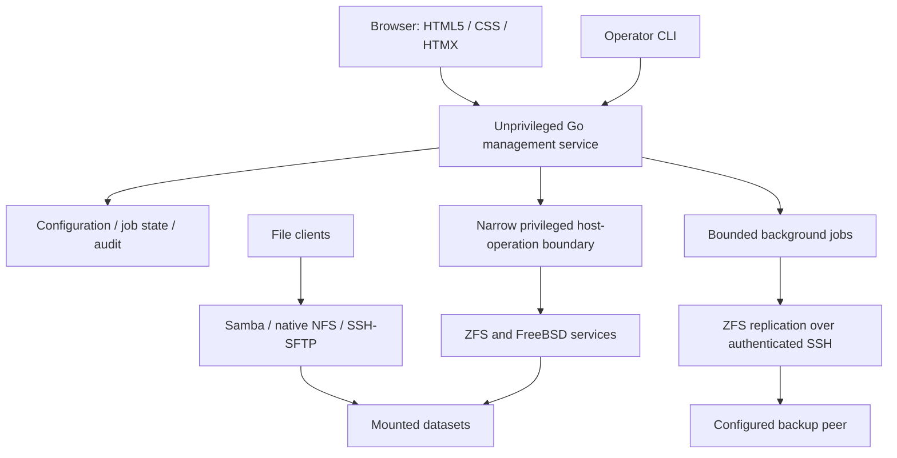

# Architecture baseline

Status: proposed engineering baseline built from agreed direction, 2026-10-03.
See [accepted decisions](../adr/README.md). Component contracts, persistence,
authentication, and privilege implementation are finalized in M1's EDD.

## Boundaries

One repository initially; distinct management, host-operation, file-service,
replication, UI, and acceptance-test responsibilities. GUI and CLI use explicit
management contracts; HTTP handlers do not invoke a general-purpose root shell.
The helper validates typed requests and authorization independently. Process
layout, transport, and capability mechanism require an ADR after a native spike.

Samba, NFS, and SSH serve file traffic directly. Reads/writes do not pass through
Go or depend on management availability. An admin restart must not stop healthy
file services. Shared paths exposed through multiple protocols need documented
ACL, identity, locking, and metadata rules; enabling two protocols is not proof
of compatible permissions.

## State and changes

Separate desired configuration from observed OS state. Define which files and
resources Horvium owns, adopts, or only observes. Detect external drift and provide
an explicit resolution workflow. Validate before applying; record intent, progress,
result, and the actor. Serialized/conflicting jobs need locking, retry semantics,
and restart recovery. Multi-step OS changes are not assumed atomic; designs must
specify partial failure and compensating actions.

Management state, service credentials, and config backups must remain recoverable
when a data pool is unavailable. Select the smallest durable persistence mechanism
that supports the approved design. No database product or config schema is chosen
by this foundation.

## Backup peers

Release one supports registering another NAS as a backup destination. Pairing
records identity, trust, target namespace, supported receive features, and access
scope. Do not silently trust discovery or changed SSH host keys. Validate ZFS
feature compatibility; do not automatically upgrade pool features. Designs cover
full/incremental sends, resume, retention, common snapshot loss, offline peers,
full receivers, and restoring to a replacement primary.

Receiver-controlled retention must limit the primary's ability to erase independent
backup history. Avoid unrestricted root SSH credentials. Replication is not
failover; replication of file data does not automatically back up identities,
service configuration, management state, or encryption keys.

## Hardware and scale

Discover disks through FreeBSD facilities and present stable identifiers. Validate
controller behavior, sector sizes, SMART visibility, and exclusive device use.
Select pool layout per deployment. Pagination, bounded collection, retention,
concurrency limits, and streaming jobs are mandatory scale concerns. Capability
checks and documented limits replace assumptions about every FreeBSD device.
No clustering framework or general message bus is required by the current scope.
