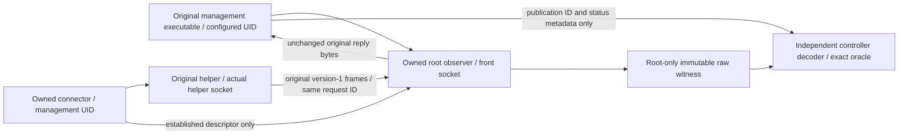

# EDD supplement: native generation witness binding

Status: Review; proposed development-only mechanism. Date: 2026-10-13.
Owner: Cam (`@gonz0w`), [issue 382](https://github.com/gonz0w/horvium/issues/382).
Authority: [PRD](PRD.md), [EDD](EDD.md), [resource supplement](resource-qualification.md),
[requirement correction](native-invariance-correction.md),
[ADR 0011](../../adr/0011-native-dashboard-witnesses.md),
[Test Design](native-witness-binding-TDD.md), DASH-REQ-002 / DASH-REQ-006.
This complete review packet requests adoption for test-only implementation. No
broker, native ABI/handoff or resource execution is claimed by this document.

## Existing correlation and scope

[Manager collection](../../../internal/observation/manager.go) chooses an opaque
nonce/counter ID, passes it to Source.Collect, and assigns that exact ID to the
published generation. A failed attempt can consume an ID without publication;
serial adjacency or a completed helper response alone proves no publication.
[Helper framing](../../../internal/helper/wire.go) carries request_id in every
version-1 begin/item/end record. [The client](../../../internal/helper/server.go)
requires exact correlation, end count/completeness and EOF before returning.

Capture that original **producer representation**, before management consumes it.
The independent oracle parses its raw integer/GUID/metadata records separately
from helper.readSnapshot, management decoding, cached queries and rendering. This
is independent presentation evidence, not an independent proof that the native
source parsed every command correctly. Preserve existing native parser, original
owned zfs witness and command/crash controls for that separate boundary.

Synthetic modes keep the original deterministic frozen oracle and direct wiring.
Only native-small and projection-10,000 receive this broker. Projection dataset
values still match the independently declared emitter exactly on every generation;
only native fields can vary according to their original producer witness. The
separate raised-cap model/byte-exhaustion synthetic pair remains directly wired
with its existing 128 MiB/200,000 transport settings. A normal broker cap must
never preempt that model-boundary test and hide the intended rejection.

## Process and privilege arrangement

Use two generated private socket paths and two root-owned fixture configuration
files containing the **existing** schema: helper points at its actual socket;
management points at the observer's front socket. Other trusted settings and token
state agree and retain original byte receipts. The observer is a separate owned
process, reexecuting the byte-verified fixture artifact; no host service/runner or
product source substitution is installed. Actual product artifacts and original
helper PID remain the native producer; the front endpoint is explicitly an observer.

The observer accepts only the original launched management process, using kernel
peer UID/PID plus its observed process lifetime, socket ownership and executable
receipt. Same UID from another process is insufficient. Validate only one inventory
request and write-half EOF, with existing frame/version/field bounds; reject all
other operations. Forward the accepted request's original bytes without rebuilding
its JSON. Do not derive a path, command or credential from its ID.

For each serialized collection, a descendant connector drops groups/GID/UID to
the configured management identity **before** connecting to the actual helper.
It receives only fixed inherited fixture descriptors/paths, and transfers exactly
one established Unix descriptor over a private parent socketpair using SCM_RIGHTS.
The observer rechecks that descriptor's peer is the original helper UID/PID/lifetime
and current owned socket incarnation, sets close-on-exec/deadlines, then acknowledges
handoff and reaps the connector. No connector carries response bytes or writes
witness files; an arbitrary descriptor or ancillary truncation fails the candidate.
No root connection to the helper is passed off as a management connection.

FreeBSD's [Unix socket manual](https://man.freebsd.org/cgi/man.cgi?manpath=FreeBSD+12.3-RELEASE&query=unix&sektion=4)
describes descriptor passing and connect/listen-time credentials; the
[credential definition](https://github.com/freebsd/freebsd-src/blob/main/sys/sys/ucred.h)
includes the PID member. These are API/source references, **not qualification of
14.5 or 15.1**. The pinned Go xucred wrapper currently hides that member. Obtain
version/size/offset/UID/PID/endian expectations from a small archived development
probe compiled against each guest's actual base headers, then qualify the fixture's
raw credential observation and descriptor handoff on both pinned releases. Record
probe source/compiler/headers/binary hashes separately from the three unchanged
product/controller artifact roles. The probe is not a runtime dependency. Refuse
unknown ABI or PID/lifetime behavior; do not guess layouts or silently use UID only.
Product hardware scope stays generic; initial native ABI evidence covers the
existing disposable amd64 profiles only.

## Original custody and bounded relay

Before starting management, the observer owns fresh root-only tmpfs storage and
its original mount/directory identity. Use a generated mode-0700 directory and
mode-0600 files on that disposable mount; never reuse an existing entry or place
raw originals on ZFS datasets whose numbers the test is observing. tmpfs use does
not imply unchanged native accounting elsewhere. Exclude operator storage entirely.
Create witness names from observer-generated slots, not request IDs.

Normal-mode limits are concrete proposed test bounds, independent of any caller:

| Item | Bound |
| --- | --- |
| Active collection/connector | One; immediate rejection rather than a queue |
| Request or response JSON frame | Existing 64 KiB ceiling; validate length before allocation |
| Response JSON payload / records | Trusted normal-mode 64 MiB / 100,000, including begin/end |
| Raw stream | Payload ceiling plus four bytes per actual bounded record; <=67,508,864 bytes |
| Original attempts | At most 32 per normal measured mode, including failed attempts |
| Original archive | 256 MiB total per guest candidate across native/projection modes; byte accounting before writes |
| tmpfs | Explicit 320 MiB size cap, covering archive and bounded indexes/metadata |
| Working relay buffer | At most 64 KiB, with bounded independent decoder allocation |
| Metadata control body | Existing 64 KiB bounded complete read; one shared control operation per new referenced ID |
| Read/write/collection deadlines | Existing trusted 45-second collection deadline, no extension or retry |

A cap failure is an explicit **observer failure**, not a source-model limit success.
It permanently denies qualification and preserves original bytes/reason/cleanup.
Do not evict old originals, truncate traces, increase caps or pace requests to pass.
These limits need measured native confirmation in the implementation PR. They are
not runtime inventory/hardware limits and do not upgrade commercial scale claims.

Spool the response's exact framed bytes and EOF into a new root-owned original
before forwarding a successful complete stream. Independently validate all echoed
IDs, begin/end ordering, exact count/completeness, duplicate/unknown fields, bounds
and trailing EOF. Record raw hash/size, actor/connection incarnation and original
file object/content identity. Seal by closing writable handles and opening a
read-only original descriptor; later users recheck object/content. An incomplete
or malformed producer reply remains a rejected original, and its same captured
prefix/EOF is forwarded for original client failure behavior. Never repair it or
manufacture a reply. Observer I/O/limit uncertainty instead closes the exchange
and permanently denies qualification, without claiming a native source control.

Forward sealed successful bytes unchanged, with exact delivered-byte/hash and
close/EOF observations. An interrupted/partial delivery is not an eligible witness.
Record candidate-complete, delivered, and publication-confirmed separately; a
complete root reply must never imply that management published it.

## Publication confirmation and oracle selection

Key originals by the complete request ID **and** original management/helper
incarnations. Within one management lifetime, require its observed ID namespace
and strictly increasing request counters, allowing genuine gaps from failed
attempts. Reject duplicates, cross-lifetime replay and mutated originals. No clock,
numeric digest or inferred ordinal is a substitute for the explicit wire ID.

Existing readiness and replacement control reads already obtain generation IDs.
Bind those IDs to delivered originals, using the existing authenticated explicit
`/api/overview?generation=G` query when confirmation is needed. Read only the
publication ID, completion/section status and counts for this purpose, and compare
that metadata with the original. Do not copy its host/accounting arrays into an
expectation. A failed publication or ID absent from current/retained cache cannot
be confirmed merely because its source reply was complete.

Use the existing pre-work overview to confirm the current ID after warm-up/idle,
and existing replacement readiness to confirm each explicit replacement. During
the 300-second request-free idle, record source traffic passively; **no additional
HTTP/control request is allowed**. If a timed HTML sample references another
background ID, register at most one shared, bounded metadata control for that ID
outside its measured request duration. Name/count these supplemental operations
in the receipt. They are not one API call per HTML sample, and never collect/refresh.
No artificial sleep, response retry or replacement delay is added. A vanished ID
before confirmation, ambiguous evidence or failed control denies qualification;
never relabel the sample expiry or infer publication from matching values alone.

After its complete bounded response read, independently extract the sample's
original generation, select a delivered/publication-confirmed witness, and apply
all exact table/comparison/scale/link/status predicates to that immutable original.
Witness preparation/lookup and controller parsing remain outside measured PIDs;
report their effect on pacing. Unknown witnesses fail the sample and the candidate.
The only allowed 409 remains replacement Overview's existing safe-expiry form.
No new tolerated denial, witness retry or byte-value tolerance is introduced.

Retained old generations keep their own originals. Retain every raw attempt for
final independent verification within the archive cap; archival presence does not
make an expired cache generation valid. Model current/latest and last-complete
retention, including partial publications, rather than assuming any two newest
attempts are both retained. Partial/rejected attempts stay separate from successful
normal-mode completeness. Stage-A identity/census invariants are checked against
the original independent fixture; accounting and collection-local metadata come
from that generation's native producer. Opaque GEOM local IDs are not invented
persistent identities. Synthetic/projection declarations never become mutable.

## Measurements, crash/recovery and cleanup

Keep original product-pair RSS/high-water, 100 ms sampling, complete-response p95
and 300-second idle CPU procedure, with unchanged budgets. Additionally require a
conservative instrumentation-inclusive RSS/high-water result to fit the same
128/256 MiB budget: original helper+management, observer, and largest connector
incarnation (single active connector is enforced). Do not sum mutually exclusive
connector RSS as simultaneous, or omit an active one. Include observer CPU plus
all connector accrued CPU inside the idle envelope, and require the same <1%
augmented idle gate. Original product-pair values remain separately available to
the unchanged legacy validator. No subtraction of estimated observer overhead.
Tmpfs occupancy, decoder/controller memory/CPU and metadata-operation counts are
reported separately; 320 MiB storage is outside RSS and is not whole-NAS memory.
Every witness/control failure or sample gap remains visible. A direct-versus-broker
calibration reports timing, collection count/cadence and RSS/CPU separately; it
cannot substitute for the exact-value workload. Reject unexplained path effects
or skipped/stretched scheduled collection work before claiming qualification.

Capture/kill the **actual helper's** native command/guard subtree using the existing
kernel owner checks, not observer/connector PIDs. Preserve old witnesses during
stale retention. A helper death rejects its pending stream; root EOF alone is not
success. Keep the observer front socket distinct from the actual stale helper
socket. Remove/restart only the verified owned actual socket; register the new
helper PID/lifetime/socket/artifact incarnation through the private fixture owner.
The manager keeps its original namespace; new attempts bind the new helper epoch.
Do not accept stale descriptors or infer a new helper from a reused PID/path.
Verify both original configuration files and token digest stay unchanged.

On completion or any failure, cancel/close observer listener, accepted/handed-off
connections, writable/read-only witness descriptors and connector socketpairs;
wait/reap only owned processes. Verify both socket incarnations absent, observer/
connector descendants empty, tmpfs original mount unmounted and directory absent,
original files/index hashes preserved in private evidence, and original ZFS/md,
artifact/boot/config/token and host QEMU/listener/key/image/variables cleanup.
Privately export bounded originals before unmount/discard; host hashes/object
receipts preserve custody through transfer. No raw inventories or credentials in
public evidence. Uncertain unmount/export/teardown denies qualification.

## Integration and evidence boundary

After adoption, deliver all related code/tests/native controls/validator/runbook in
one implementation PR. Keep the current resource runner's old oracle active until
integrated fixture review and both-release short gate results are accepted.
Version the supplemental original-witness coverage contract: per sample it binds
observed generation, root original/forwarded hashes, confirmed publication and
original predicate result. Use private full IDs with sanitized public witness
references/hashes/counts; independent verification opens the private originals.
Existing frozen-oracle/historical schemas retain their old meaning and cannot
pass the new native-witness gate by a label change. Legacy budgets/controls remain
necessary but insufficient. No public runtime wire/API/config change is needed.

The full four-mode, 2,000-observation, warm-up/idle/replacement/native/crash/cap and
strict-plus-legacy both-release procedure follows integrated review. Historical
failures stay failed, and the large-mode latency problem still needs a measured
correction. #382 and wider acceptance remain open; runtime writes stay disabled.
