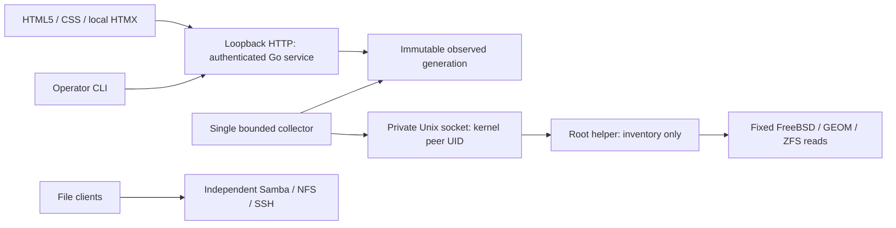

# EDD: native discovery and read-only console

Status: Approved; implementing in reviewed slices. Owner: Cam (`@gonz0w`). Date: 2026-10-03.
Approval: maintainer merge of [PR 3](https://github.com/gonz0w/horvium/pull/3),
source `527a330f4b1069fa0b7a1414f4d3c6dbab54f5a5`, on 2026-10-03.
[PRD](PRD.md), [Test Design](TDD.md),
[research](../../research/M1/findings.md).

## Process and ownership boundaries



One Go module, standard library first; distinct application, HTTP/CLI, inventory
model, FreeBSD adapter and helper transport packages. FreeBSD-specific adapters
use build constraints; unsupported development hosts use explicit fake fixtures
and never pretend to return real FreeBSD inventory. Research programs remain
outside the product build. CLI and HTML adapters share application query/refresh
contracts; the CLI does not bypass authentication or open a root command channel.

The management process uses a dedicated non-login service UID. It neither runs
as root nor reads storage devices. The root helper owns no web listener. Its Unix
socket lives in a root-owned directory (0750, restricted service group), socket
0660. It verifies `LOCAL_PEERCRED`, credential ABI version, and the exact configured
management UID on each accepted connection. Payload UID/group/username is never
authority. A shared group alone is insufficient. Client verifies helper UID 0;
the root-owned socket directory prevents socket substitution by the service user.
No arbitrary command, executable path, device argument, shell, or environment is
accepted. Startup fails if socket ownership/permissions or UID configuration are
unsafe; no permission widening fallback.

The proposed FreeBSD syscall adapter is `golang.org/x/sys/unix` v0.48.0, BSD-3-Clause,
for `GetsockoptXucred`; its Go 1.26 minimum fits Go 1.27.1. Source pins are in the
manifest. Use `UnixConn.SyscallConn.Control` for credential lookup, verify the
returned version and errors before reading requests, and test the actual Go
wrapper natively. The C spike is evidence about the kernel ABI only. Add the
module checksum, third-party notice and update configuration when a reviewed
product module is introduced. No general RPC/web framework or runtime C/Python
dependency is proposed.

## Collection and native contracts

One collector invokes a versioned inventory request. The helper uses absolute
base executable paths, fixed argument lists, sanitized environment (`LC_ALL=C`,
minimal PATH), deadlines and bounded stdout/stderr. No shell. OS version probes
record installed/running kernel and userland separately; typed sysctl values
provide physical memory and architecture/capabilities.

GEOM XML comes from `/sbin/sysctl -b kern.geom.confxml`; decode with Go
`encoding/xml` and depth/element/byte limits. Preserve class/provider relationships
and integer sector/media sizes. GEOM graph IDs are local to a collection, not disk
identity. Device names such as `ada0` are paths, not durable identities. Expose
available serial/lunid and provenance; absent or duplicate values mean uncertain
identity. A pool GUID and dataset GUID are decimal strings (avoid browser number
precision loss), distinct from their names. Do not flatten partitions/multipath
providers into multiple physical disks or declare an observed disk safe for use.
Physical serial/controller behavior still needs the hardware lab.

Baseline projections work across the selected bundled ZFS versions:

```text
/sbin/zpool list -H -p -o name,guid,size,alloc,free,health
/sbin/zfs list -H -p -t filesystem -o name,guid,used,available,referenced
```

Parse exact tab-separated fields and literal integers; reject malformed rows,
overflow, control characters in names and unknown incompatible output. Empty
success is different from command failure. Use batch queries, never spawn one
process per resource. Arbitrary mountpoint/property strings can contain delimiters;
they are omitted from this projection until a separately verified encoding exists.
The newer `-j` JSON flags are not assumed on older bundled ZFS. Pool `health` is
the reported pool enum, not SMART, full vdev topology, or a health guarantee.
Unimplemented service/share/SMART/protection sections display “not collected”.
No native source output is rendered as trusted HTML.

Crash-containment refinement under review: wrap each fixed native projection in
FreeBSD base `/usr/bin/timeout`, at most ten seconds or the shorter remaining
command deadline, with SIGKILL as its expiry signal. Its reaper owns the command
subtree. Go's FreeBSD parent-death signal sends SIGALRM to that guard when the
helper dies; normal cancellation does the same. Guard stderr consumes the same
output budget; failed/timeout output is never published. The guard has no network
listener, receives no client-selected arguments, and is included in native
resource measurements. See [procedure and evidence](../../testing/M1/crash-containment.md).

Helper wire contract (version 1, internal): one typed `inventory` request with
request ID and no device/path parameters. Length-prefixed JSON records carry
source metadata, typed items, section errors and an explicit end marker. Each
record is capped at 64 KiB; aggregate decoded collection defaults to 64 MiB and
100,000 records. Enforce bounds before allocation, including nesting/string sizes.
Unknown version/operation/fields, truncated stream or absent end marker fail the
collection. Socket I/O has deadlines; bound admitted clients and in-flight work.
Default limits can be raised through root-owned validated configuration with
corresponding measured budgets. HTTP clients cannot change them.

Collection is observed state, not an atomic host transaction. Record start/end
times and per-source result. A dataset may disappear between probes. A completed
collection can be partial; publish it with section errors and explicit completeness.
An interrupted transport cannot publish a falsely complete generation. Keep the
last complete generation as stale context if the next transport fails, without
erasing visible error state. Retain at most two bounded generations; replace
atomically for readers. No indefinite accumulation or implicit retry loop.

Collect on startup and every 30 seconds, deduplicating manual refresh. One worker,
no queued duplicate refreshes; failure retries at the next bounded scheduled
interval. Ten-second per-command deadlines plus a 45-second total collection
deadline. After 90 seconds without successful section data, label that section
stale. Freshness is per section, not the timestamp of a successful unrelated probe.
Pages filter/sort/paginate cached data without spawning collection commands.
Paging carries a generation ID; expired generation returns a clear reload result,
never silently combines resource rows from different generations.

## Administration, configuration and persistence

M1 listener binds only explicit loopback addresses; reject wildcard/non-loopback
configuration. Remote operator access uses an SSH local forward. Exact allowed
Host values are startup configuration; enforce them even for safe requests to
resist DNS rebinding. Do not trust forwarded headers. Direct network HTTPS,
reverse proxies, password login and multi-user administration are later designs.
HTTP over loopback is an M1 lab access mode; it is not the final remote-admin model.

An explicit local setup action generates 32 cryptographically random token bytes,
displays the token once to the operator, and atomically stores only its SHA-256
digest in a service-owned 0600 file inside a 0700 state directory. Never pass it
in command arguments/URLs, print it in logs, embed it in assets, or commit it.
Use constant-time digest comparison. SHA-256 is appropriate for this high-entropy
random token; it is not proposed for human passwords. OS administrators rotate
it locally and restart management; there is no unauthenticated web setup endpoint.
CLI reads the token via a terminal prompt or protected input, not process argv.

Successful login exchanges the token for a random opaque server-side session,
held in bounded memory. Maximum eight sessions, 15-minute idle expiry and eight-hour
absolute expiry. Login failures have per-source and global bounded throttles;
do not use forwarded-IP claims. Cookies are HttpOnly, SameSite=Strict, Path=/,
with no Domain. M1 loopback HTTP cannot use a Secure cookie; require Secure when
HTTPS is designed. Logout and restart invalidate sessions. Do not promise session
survival. Authentication precedes inventory lookup; responses use Cache-Control:
no-store. No inventory is returned from an unauthenticated health endpoint.

Full pages and fragment endpoints both require sessions. Login has a bounded
short-lived pre-auth challenge; login/logout/refresh require CSRF tokens and
same-origin checks. Go `http.CrossOriginProtection` supplements these checks:
it permits safe methods and requests lacking both provenance headers, so it is
not the only authorization/CSRF control. Reject missing/mismatched tokens, unknown
origins, unsupported methods/content types, oversized bodies and expired sessions.
CLI authenticates via the same exchange and supplies its resulting session/CSRF
credentials; no unauthenticated loopback exemption.

Go `html/template` escapes all observed strings. Self-host pinned HTMX 2.0.11;
set selfRequestsOnly=true, allowEval=false, allowScriptTags=false,
includeIndicatorStyles=false, historyCacheSize=0. No `hx-on` or evaluated filter
expressions. CSS owns indicators; a small local script configures HTMX if needed.
CSP permits only local assets, with no unsafe-eval/inline exception; form-action
self, frame-ancestors none, base-uri none. Test these exact interactions in browsers.
Use semantic links/forms for full-page equivalents; fragment requests do not
change authorization. Preserve focus and prevent automatic refresh of active
resource details; background updates announce freshness without disruptive focus.

Root-owned static config owns listener/allowed Hosts, helper UID/socket, and safety
budgets. Parse a strict versioned format; reject unknown fields and invalid limits
before serving. Final config field names are finalized with implementation tests.
Only the explicit setup action writes the token digest. Observed inventory and
sessions are volatile; there is no persistent inventory database or job store in
M1. Configuration/token state belongs on the boot/system storage so a missing data
pool does not prevent admin startup. No ZFS property, share config, user database
or unrelated host file is owned/adopted by this milestone.

## Failure, observability and delivery

Helper outage shows error/stale context and bounded retry; HTTP remains responsive.
Restart clears cached inventory and sessions, reloads validated config, and starts
a new collection. Initial unavailable inventory has explicit placeholders rather
than example metrics or zeros. Unknown output is a capability error, not fabricated
success. External changes appear in the next generation without apply/repair.
M1 has no apply transaction, rollback, resumable job, or destructive-action route.

Structured logs record timestamp, request/collection ID, section, duration,
outcome and error class. Redact tokens/cookies, request bodies, raw command output
and host identifiers from exported test artifacts. Bounded log volume integrates
with system logging; no telemetry export by default. File daemons are independent:
management/helper do not start/stop/reload them. Later package scripts must preserve
this property and operator data/configuration.

Before product work: approve PRD/EDD/Test Design and proposed ADRs. Then build
test-first slices: models/parser errors, helper auth/framing, collector/cache,
HTTP/session/CSRF, CLI and accessible console. Use native Go tests on both releases,
plus real browsers and memory/latency tests. The QEMU spike reduces risk but does
not satisfy product test IDs. Port constraints guide file layout and dependencies;
no installable port or rc.d enablement is claimed by M1. Install/upgrade/deinstall
qualification remains M5. See [ports plan](../../../packaging/ports/README.md).

Revisit loopback/token access before M3 or any deployable service; revisit budgets
when measured workloads exceed defaults. Replication/state/key/identity decisions
belong to later active designs. No claim of large-host qualification follows from
synthetic inventory or QEMU success.
