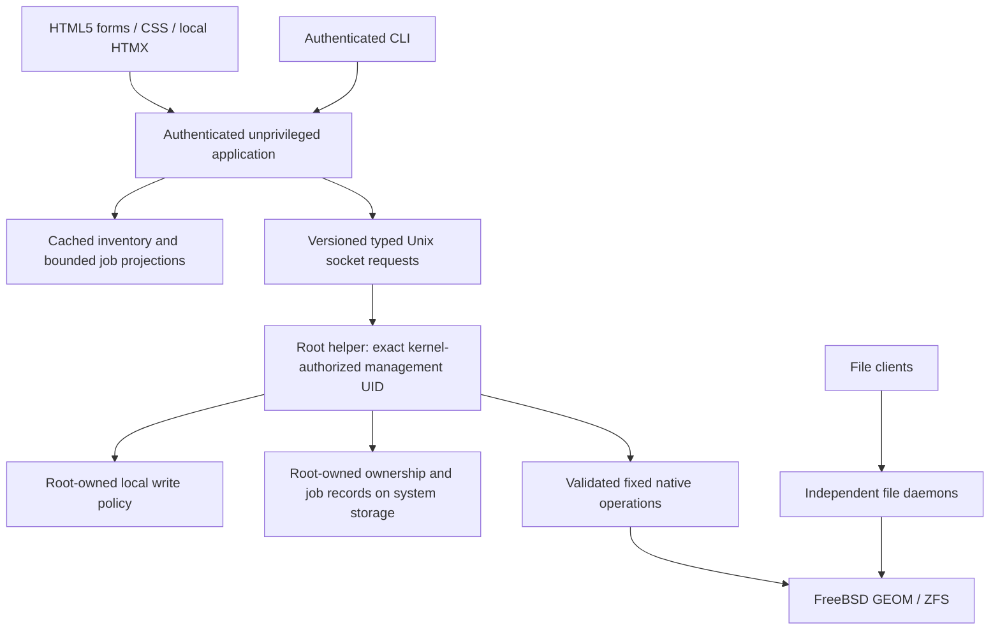

# EDD: owned ZFS operations and durable recovery

Status: Implementing; design approved. Owner: Cam (`@gonz0w`). Date: 2026-10-04.
[PRD](PRD.md), [Test Design](TDD.md), [issue 19](https://github.com/gonz0w/horvium/issues/19),
[primary evidence](../../research/M2/findings.md).

Approved by Cam (`@gonz0w`) on 2026-10-04 through maintainer merge of
[PR 20](https://github.com/gonz0w/horvium/pull/20), source
`753f601960529cd17596d0ffc628afe38d041c82`. Design approval authorizes the
reviewed slices; it is not M2 acceptance or native qualification.

## Boundaries and authority

Retain the M1 UID/peer/socket safeguards and authentication/session/CSRF/Host/Origin
policy. Mutation authority is a new, explicitly negotiated transport contract;
old/unknown operations fail closed. HTTP handlers, templates and CLI adapters
never construct native commands or access the root ledger. No general command,
path, environment or property map crosses the boundary. Exact serialization and
routes are implementation details reviewed in their implementation slices.

Writes are disabled unless OS root explicitly enrolls eligible stable device
identities and pool/dataset scopes in local root-owned policy. The helper checks
that policy independently of management-supplied claims. Adoption needs an enrolled
pool GUID; an observed pool, root client, shared group, forged actor or ZFS marker
cannot grant authority. Created resources acquire only the scope derived from the
enrolled devices/parent and verified operation. Changing policy invalidates pending
plans and queued work that no longer qualifies.

M1's random-token administrator remains the lab application actor. Audit records
bind the kernel-authenticated service UID and authenticated application context;
an asserted human name is not independently verified identity. A compromised
authorized management process can exercise enrolled operations, so enrollment
must be narrow. OS root compromise and competing root mutations cannot be fenced
by this boundary. No claim of per-human RBAC, remote HTTPS or production identity
management is added; those still precede deployment.

## Ownership and device identity

The root registry maps pool GUID, filesystem GUID, selected parent/namespace,
origin (created/adopted), approved property scope and policy revision. Names are
current addresses. GEOM graph IDs and device paths remain transient observations.
GUIDs stay validated decimal strings; literal capacity values never pass through
browser floating-point arithmetic. New names follow a reviewed subset of native
rules and reject controls, option-leading values, reserved layout keywords and
unsafe path components. Existing unsupported names remain observable only.
Adoption records a baseline without changing ZFS properties, mounting, importing,
modifying cache files or taking ownership of every descendant. Missing/adverse
capabilities preserve observation but block the affected mutation.

Pool creation and replacement-device selection target direct local devices with
unambiguous stable serial/lunid provenance
and verified GEOM backing relationships. Resolve every selected identity freshly
to its provider and actual geometry, collapse aliases, and reject overlapping
parents/children, duplicate/absent identifiers and uncertain multipath mappings.
Check partitions/signatures, GEOM consumers, imported/exported pool membership,
mounts, swap, boot/root backing and pending job reservations. An empty consumer
list alone is not proof of an unused device. A failed, truncated or unsupported
check denies creation/replacement. No wipe, partition, label-clear or force escape
exists. Record the exact identity/use-check native projections with their tests
before enabling device operations; enumeration is not a destructive allowlist.

No shared SAN/multi-host block ownership is supported. Local inspection cannot
prove a remote host is inactive. Native last-moment use checks supplement the
plan but do not reserve a device or defeat another root actor. Managed mutation
assumes an exclusive local writer; operators pause Horvium writes before external
changes. Observe drift before/after each operation and suspend affected scopes.
Never describe an advisory file lock as ZFS/GEOM fencing.

Enrollment-review prerequisite: a volatile immutable review of an explicitly
selected member-bearing root proposal retains complete unselected native context
and normalized full system/imported-pool facts. Require fresh member/system
correspondence, false eligibility, random context-bound ID, five-minute expiry,
owned copies, pre-copy working bounds and an exact 64 KiB complete review ceiling.
Fresh validation detects proposal/native/system drift without deriving scopes,
claiming a plan, publishing policy or changing storage. The context string is not
root authentication. Runtime provisioning still needs kernel authorization,
predecessor/backing/capacity/recovery checks and atomic single-claim durability.
No new durable schema or public transport is added. See the
[contract](../../testing/M2/property-enrollment-review.md).

Root-state enrollment amendment: bind the volatile proposal review to one held
root lease and a complete inspected record/backing baseline. An entirely zero
predecessor explicitly requests absence/revision one; otherwise compare the exact
canonical predecessor and next revision. Project whole-temporary capacity, retain
all job holds, include the proposed owner in system-backing exclusions and latch
orphan uncertainty. Fresh validation repeats native/expiry/context and complete
metadata/backing checks through the original lease. No publication, claims,
recovered-state authority, runtime workflow or eligibility is added. See the
[contract](../../testing/M2/property-enrollment-state.md).

Native enrollment-source amendment: accept only explicit typed root proposal and
predecessor selections; validate and own them before fixed independent native
pool/provider/system collection. Join the bounded volatile review to its borrowed
root lease, repeat full state validation and actual clock/context checks before
returning. Fresh revalidation recollects native inputs through the original sealed
binding. No authority transfer, inferred selections, publication, recovery clearance
or runtime consumer is added. See the
[source contract](../../testing/M2/native-enrollment-source.md).

## Plans and application contract

1. Authenticated UI/CLI submits a typed operation and resource selection. The
   helper independently creates a bounded plan from fresh native observations
   and local policy; browser names/paths cannot identify a device for execution.
2. The immutable review shows exact identities, layout, sector alignment, property
   sources/values, mount targets, descendants affected, conflicts, irreversible
   effects, unsupported capabilities and recovery/cancellation limits. Pool
   creation/replacement require explicit confirmation of the displayed targets.
3. A root-generated random plan identifier binds normalized intent, expected
   identities/properties, policy revision, operator session context and expiry.
   Default expiry is five minutes. Editing, policy change, restart or drift requires
   fresh review. Confirmation text conveys intent; it is not extra authentication.
4. Submission claims the plan once, obtains resource reservations, repeats live
   checks and durably admits the job before any write. A duplicate submission
   returns that job. Reusing a submission identifier for different intent is denied.
   A dropped HTTP response never authorizes retrying the native change.
5. The helper persists applying intent before launch, executes only an allowlisted
   operation, then independently observes GUID/topology/property/scan state.
   Success requires both the native postcondition and a durable outcome record.

Cached generation cursors still protect UI consistency; they do not replace
live execution checks. Persistent jobs survive logout/restart, while sessions and
unsubmitted plans do not. Accepted work continues independently of an HTTP request
or management disconnect. Cancel is a separate authenticated typed request.

## Operation contracts

| Operation | Preconditions and verified outcome |
|---|---|
| Adopt | Eligible imported non-system, unencrypted pool; recognized supported layout/features; enrolled GUID and individually selected filesystem scopes; record baseline without changing storage |
| Create pool | Unused enrolled devices; homogeneous mirrors (at least two leaves/group) or RAIDZ2 (at least four/group); no mixed replication/special classes; reviewed geometry and installed common feature profile; root dataset unmounted and `cachefile=none`; verify new GUID, leaf identities, topology and exact properties |
| Create filesystem | Owned eligible parent, absent valid direct child name, no implicit ancestors; create initially unmounted with reviewed properties and a root-generated operation nonce; independently record GUID; mount only the new filesystem at a separately validated target |
| Change properties | Same filesystem GUID, expected local/effective/inherited values, allowed quota/refquota/compression only; explicitly show descendant inheritance impact; one reviewed property step at a time and observe each result; no recursive/native arbitrary-property input |
| Start/stop scrub | Same owned pool GUID, supported status adapter and attributable scan episode; reject conflicting resilver/scan; observe scan acceptance/termination and checksum errors, not just utility exit |
| Replace | Same pool and leaf vdev GUID, supported redundant topology, adequate remaining replicas, distinct unused enrolled replacement and native size/alignment checks; verify new member then observe completion/health/errors; no force, detach or sequential rebuild mode |
| Reimport created pool | Registered created-pool GUID and original verified devices/features, no conflicting import or old executor; limited native search and no force/rewind/key loading; import without mounts and preserve `cachefile=none`; verify identity before recovery |

Use fixed absolute base executables, sanitized environment and typed arguments.
The existing read-only timeout/reaper is not a transaction or a recovery design.
Native mutation control calls have bounded capture and a proposed 60-second
launch deadline; reads retain M1 bounds. A launch timeout/cancel/abrupt death is
an uncertain write outcome, not proof of no effect. Scrub/resilver themselves run
in ZFS and can outlive the launching utility/helper; no userspace deadline is a
promise to roll back or finish them. Do not keep a long-lived utility per job.

New pool creation uses the source-pinned common `openzfs-2.2` profile only after
the installed root-owned file/hash and native cross-release behavior qualify.
If absent, altered or unsupported, creation is unavailable. Do not fall back to
`compatibility=off`, silently enable features or upgrade an adopted pool. The
profile constrains features; M4 still negotiates receiver/send compatibility.

Quota includes descendants/snapshots; reference quota limits the filesystem's
referenced space. Neither reserves space or supplies a backup policy. Show literal
bytes, ancestor constraints and unknown usage. Do not assume compression savings
or a guaranteed usable capacity from the sum of disk labels. Property changes
retain original source/inheritance and untouched values for reviewable recovery.
Quota changes accept a positive literal byte limit or an explicit no-limit choice;
empty/zero/overflow/ambiguous inputs are denied. This scope sets local values only;
it does not add arbitrary inheritance or received-property restoration commands.
If a parent quota or inherited compression change would affect an unadopted
descendant outside the enrolled property scope, deny it. Require a complete bounded
impact observation and explicit scope enrollment; a paged UI or partial inventory
cannot silently omit affected descendants or adopt them on the operator's behalf.

Mount paths come from locally approved namespaces and validated names, never
arbitrary request paths. Check anchored directory descriptors, ownership, symlinks,
existing mount points, nonempty targets and shadowing before mount. Adopted
mount/import/cache policy is preserved. System/boot pools, volumes, encrypted
resources and unqualified topology/provider classes stay outside mutation scope.
M2 does not install services, change boot configuration or enable auto-import;
M5 must qualify that lifecycle. Reboot recovery may require an explicit reviewed
reimport for created pools; adopted pools remain the OS/operator's responsibility.

## Durable state and scheduling

Use standard-library strict versioned JSON records rather than adding a
database dependency: [ADR 0007](../../adr/0007-durable-storage-jobs.md). Ownership,
job intent/current outcome and limited audit events live on system storage in
root-owned 0700 directories/0600 regular files. The service UID sees only bounded
authenticated projections. Reject symlinks, unsafe ancestors, unexpected ownership,
unknown versions/fields, duplicate keys, oversized records and checksum mismatch.
Checksums detect damage, not malicious root modification.

Member-baseline amendment: version 2 ownership records retain the version 1
scope contract and add explicit nonempty members, sorted by vdev GUID. Each member
records a unique canonical GUID, unique serial with exact native provenance,
media/logical-sector size and observed stripe size/offset. Do not persist device
paths or GEOM IDs, infer physical sectors, or infer locality from serials. Both
closed schemas are strict and share the 64 KiB ceiling; version 1 bytes remain
unchanged and readable. No automatic migration or enrollment occurs. The complete
property safety path requires every member to match fresh correlated native
observations; legacy/partial/mismatched records refuse with no result. Include
member facts in the immutable policy hash. This is an enrollment prerequisite,
not provisioning or write authority; runtime eligibility remains false. Older
code refuses version 2 rather than rewriting it. See the
[member contract](../../testing/M2/property-member-enrollment.md).

Native capability amendment in the reserved-submission PR: metadata publication
requires ZFS or UFS without soft updates. Actual softupdates UFS ctime drift and
pinned deferred-removal source prevent qualifying its strict metadata windows;
refuse publication and submission retry acknowledgement on that backing. Keep
read/inspection drift checks, and never change mount/tunefs settings automatically.
Qualify supported backing and actual softupdates denials on both releases using
owned disposable fixtures; root filesystem alone is not evidence of the backing.
See [the contract and finding](../../testing/M2/property-submission.md). This gate
must reach runtime write eligibility before executable admission.

Property-state inspection amendment: a separate read-only composed observer checks
complete private records and the selected canonical policy under the held writer
lease. Kernel statfs backing must match the fresh complete system mount/provider
view and be ZFS or UFS without soft updates/read-only flags. Initially qualify
backing mounted at `/`, `/boot`, `/etc`, `/usr`, `/var`, `/root` or descendants
of those non-root system namespaces; arbitrary separate data mounts are denied.
Refuse backing on or sharing physical disks with any enrolled imported pool.
Every nonterminal retained job suspends this check until executor/recovery
validation; every retained job on the selected pool, including terminal labels,
keeps its hold. Do not repair, evict, release or replay anything. Orphan uncertainty
latches the lease's existing publication block even if a root actor removes the
orphan. Compare bounded mount identity/capability fields again before success;
sequential views are not an atomic fence. This is not restored-state or executor
quiescence validation; runtime eligibility remains false. See the
[property state contract](../../testing/M2/property-store-readiness.md).

One helper holds a lifetime nonblocking advisory lock on a stable root-owned lock
file. A second writer fails; do not unlink/recreate the lock inode. Strictly parse
each bounded record before using it. Write a unique same-directory temporary
file, sync it, rename to publish, then sync the parent directory. Admission/applying
acks require durable intent. Registry and job changes are not a fictitious
cross-file transaction: durable job intent leads; registry updates are reconstructed
from verified postconditions and each transition is recoverable. Directory-sync
support and failures must be tested on actual FreeBSD system-storage fixtures.

Default bounds: 64 KiB per plan/record, 64 nonterminal jobs, four outstanding
kernel-maintenance jobs, one native mutation launch, 1,000 terminal records and
64 MiB total metadata. Each job retains a bounded transition history; cap
repetitive progress observations in memory rather than syncing every poll. Prune
only eligible terminal records, preserving a durable submission tombstone through
its replay window (at least 24 hours); expired submissions cannot be re-admitted
from old plans. Ownership and nonterminal/uncertain jobs are never evicted to fit.
Exhaustion rejects new work before launch and keeps existing recovery visible.

One reservation covers an entire pool plus relevant device identities and target
namespace. Pool creation reserves all devices and its name; replacement reserves
the pool and new device. Conservatively serialize changes within a pool, including
active maintenance, while cached reads and work on other pools continue. Waiting
jobs are bounded and revalidate before execution. Local policy may raise tested
limits to eight launches/64 maintenance jobs; byte/history/ownership limits also
need validated ceilings and workload evidence. Bounds are explicit capability
limits, not promises that every commercial deployment fits the initial defaults.

## Job states and recovery

Conceptual states: queued, applying, observing, succeeded, failed, cancelled,
and reconcile-required. Include a durable reason and last verified observation;
missing/unavailable storage is a reconcile-required reason, never success. Native
scan completion with checksum errors produces a failed maintenance result while
preserving the actual completed scan state. Cancellation before launch is durable
and has no storage effect. A stop-scrub request is a separate verified operation;
replacement and an in-flight control call have no general safe cancel button.

On helper restart, acquire the singleton lock, validate policy/store and enumerate
nonterminal jobs in bounded pages. Before writes, establish whether an old executor
can still exist using recorded boot/process identity and containment evidence;
a PID alone is insufficient. Failure to establish quiescence holds reservations
and requires reconciliation. Parent-death signals and a killed userspace command
do not prove that a kernel-side mutation ended.

Never replay applying/observing work automatically. Reconcile by GUID, fresh
membership, expected properties and attributable scan state. Creation carries a
root-generated nonce in a narrowly defined internal ZFS property at creation;
combine it with the durable intent, device set and observed GUID to correlate a
created resource after an acknowledgement gap. A copied marker or matching name
alone grants no ownership. If attribution is ambiguous, keep the job unresolved
and preserve the resource; never destroy it as compensation.
If a reboot leaves a possibly created pool unimported before its GUID was durably
recorded, the registered-pool recovery operation cannot import it on a name/device
guess. Keep it unresolved for explicit OS-root-assisted inspection and a new
baseline review. A nonce is corroboration after safe observation, not authority
to import an otherwise unregistered pool.

Queued pre-launch jobs become reconcile-required with a review-expired reason after
restart; they do not execute under an expired session/plan. The operator cancels
that known-unlaunched job before submitting a newly reviewed plan. A scan that
completed while its acknowledgement was
lost may remain indeterminate if completion cannot be attributed. Recovered native
activity is observed rather than restarted. Recovery import for a created pool
uses its held reservation and verified identity; ordinary jobs cannot bypass an
unresolved reservation. A renamed GUID is shown with its new address and drift;
changes wait for an explicit new baseline review.

Store-full/sync/I/O failure after a native effect leaves the last durable applying
intent for reconciliation; never return success or rerun the mutation. A missing
data pool does not prevent administration starting from system storage. A damaged,
missing or incompatible ledger disables writes; observations remain available
with a clear error. Do not silently reset the registry and adopt whatever exists.

Job success is not data restoration. Preserve a root-controlled consistent metadata
backup/export with schema revision and no authentication secrets; restoration must
reconcile every GUID/identity/job before enabling writes. Fresh root confirmation
is required after restoring older metadata. Refuse unsupported newer state versions
without rewriting them. M5 defines package/state migrations; M4 defines file/key
backup. There is no automatic destructive rollback of created pools, filesystems,
replacement or inherited property changes.

## UI, observability and acceptance

Use the [BSD Classic baseline](../../ui/baseline.md). Full HTML forms and CLI share
the reviewed plan and durable job semantics. HTMX adds dependent selections and
bounded job polling; JS-disabled operation remains complete. Preserve focus and
selected identity during refresh, announce status changes and show unavailable
capabilities, capacity/inheritance consequences and cancellation limits in text.
Keep confirmation visible across pages; never silently substitute a newer plan.

Audit typed operation, generated job/plan identifiers, verified caller context,
policy revision, affected identities, transitions, timestamps and fixed outcomes.
Local root records may need identifiers; exported test artifacts remain sanitized.
No token/cookie/raw command output in HTTP or operational logs. Bounded logging
failure is reported; durable apply intent must still precede storage mutation.

All [Test Design](TDD.md) gates are required for claimed M2 behavior. First build
ownership/planning and durable state with denial/restart tests, then qualify each
native operation before exposing it to UI/CLI. Native failures block that operation;
do not widen commands, force flags or unknown output handling to make a test green.
The ADRs and scope were approved in PR 20. Native implementation findings
that change a contract require a reviewed amendment to all affected documents.

## Reviewed root enrollment metadata publication amendment

A sealed root-state binding may explicitly publish its reviewed ownership record
with independently fresh trusted native inputs. The plan's shared volatile claim
permits one attempt across copies/rebindings; native publication repeats actual
kernel UID 0, complete baseline/predecessor/backing/hold/capacity checks under the
original lease and actual clock/context guards around staging and rename. Use the
accepted unchanged sync/rename engine. Every attempt is consumed, uncertainty
blocks the lease, and actual successful late acknowledgements are reported without
replay. No format migration, native eligibility, runtime adapter or restored-state
clearance follows; see the [contract](../../testing/M2/enrollment-publication.md).

## Independently collected enrollment publication amendment

The internal native enrollment source accepts only a sealed root-state binding
and its context for confirmation. Derive the explicit selection from owned review
copies, independently repeat all fixed pool/provider/system collectors and apply
a 135-second parent deadline with clock/context checks before and after collection.
Finish only through the accepted original-lease, one-attempt metadata publisher;
return its actual acknowledgement unchanged even after cancellation/expiry. No
caller-supplied observations, renewed claim, storage operation, restored-state
clearance or runtime authority is added. See the
[contract](../../testing/M2/native-enrollment-publication.md).

## OS-root retained job-status diagnostic amendment

The foreground `storage-jobs` command takes an explicit existing private storage
ledger path. Acquire the accepted root lease, validate the complete namespace and
inspect all retained jobs from one immutable view before releasing the lease and
emitting output. Separate historical last events from conservative restart status;
state explicitly that recovery is unverified and holds are retained. Stage all
summaries under the accepted 1,064-job/1 MiB diagnostic bounds and preserve all
records/lock identity on refusal. Initial empty-lock creation/sync remains the
existing opener contract. No native collection/write, policy/job publication,
management transport, repair/replay or service is added. See the
[contract](../../testing/M2/storage-job-status.md).

## Reviewed property postcondition amendment

Compare one immutable property intent with independently fresh complete collected
observations and unchanged trusted policy without requiring or supplying native
write eligibility. Require exact selected local value/source/supplier, retained
received columns, compression inheritance and protected overrides, and unchanged
relevant review/policy context. Preserve the original precondition gates. A match
is an observed fact and cannot attribute execution, grant admission, release
holds, clear recovery or acknowledge durable job success; even an already-matching
value may match. See the [contract](../../testing/M2/property-postconditions.md).

## Retained property-job assessment amendment

The [assessment contract](../../testing/M2/property-assessment.md) joins immutable
property-job binding to two independent fresh graph comparisons and the accepted
conservative restart summary. Validate the complete graph and trusted policy before
returning any result; errors expose zero, and valid context/policy drift matches
neither. An already-matching value may match both. Retained labels remain unchanged,
including terminal labels on a differing graph. Neither match supplies attribution,
quiescence, restored-state validity, replay, resolution, durable success or release.
False eligibility remains false; no clock/session/review authority is restored.
This is a read-only prerequisite for actual recovery, not a recovery coordinator.

## Root-leased native property-job assessment amendment

The [source contract](../../testing/M2/native-property-assessment.md) selects an
opaque job ID and joins two complete protected ledger reads to independent native
policy/property collection through the original root lease. The census fingerprint
binds every sorted record name and actual bytes with length framing; selected
canonical job bytes must also match. Existing budgets, strict root/ACL/object/
namespace checks and held jobs stay intact. Ordinary drift/cancellation discards
the entire result; equivalent restored bytes cannot supply root fencing or restored
state validity. This read-only source permits no caller-supplied native observations,
publication, replay, resolution, release, write eligibility or durable success.

## Foreground native property-job assessment amendment

The [diagnostic contract](../../testing/M2/property-assessment-diagnostic.md)
exposes the accepted root-leased source to OS-root operators through one explicit
ledger path and canonical retained job ID. Independently collect all native facts
through that source, preserve complete ledger drift checks and close the original
lease before staged bounded output. Separate fresh baseline/expected-effect facts
from historical events and conservative restart labels; state false executor/
recovery verification and retained holds. Validate selection before access, use
fixed errors and bound collection/output cancellation. No command replay, native
write, publication, reconciliation resolution or management transport is added.

## Read-only pool health and scan amendment

The [observation contract](../../testing/M2/pool-health.md) adopts the pinned
common legacy scan formatter and binds complete GUID/path status to fresh pool
identity/import and release brackets. Return unhealthy facts, owned topology and
reported typed scan state with finite shared capture/time limits. Unknown or
drifting output returns zero. Preserve mutation eligibility checks; this observer
contains no authority or durable outcome. Rounded native values remain display
text, and terminal scan labels provide no executor attribution. Full scan formats,
attributed jobs and authenticated management integration remain separate gates.

## Native scan-state fixture amendment

The [fixture contract](../../testing/M2/scan-lifecycle-observations.md) adopts the
pinned native scan-progress debug switch solely for disposable qualification.
Require explicit guest/root opt-ins, expected zero baseline, no other active scan,
GUID-bound owned pool commands and restoration/reread on every exit. Actual
status, pause/resume/stop and completion are never replaced with synthetic
results. This changes no product reader, authority, executor or write workflow.
Held progress is not advancing-progress or attribution evidence.

## Native repaired-checksum fixture amendment

The [fixture contract](../../testing/M2/checksum-findings.md) adopts base zinject
read-buffer corruption solely inside an opted-in disposable guest on one bound
leaf GUID. Independently collect actual checksum counters, scan completion and
error counts; preserve the healthy replica and generated content. Arm cleanup
before effect, clear only the acknowledged ID, verify absence and child/pool
GUIDs before fixture destruction. Unknown acknowledgements require discarding
the guest. This adds no product fault injector, write authority or job outcome.

## Property execution sequence amendment

The [contract](../../testing/M2/property-execution.md) adopts a portable one-attempt
worker sequence under the existing root/native authority boundary. Independently
obtain a queued job and its original live plan/session claim, compare fresh
eligible facts, require exact durable applying acknowledgement, refresh through
the same claim/lease, invoke one typed property step and verify actual quiescence.
Independent complete postconditions and exact observing/outcome acknowledgements
precede success. Lost/foreign publication acknowledgement stops work; ambiguous
control/facts retain reconciliation holds and no automatic replay. This composes
existing codecs without changing durable schema. No product native adapter or
scheduler implements the trusted contract; false native eligibility, root/live
claim, process containment, restored-state and real interruption gates remain.

## Private native property-control amendment

The [contract](../../testing/M2/property-control.md) adopts a private one-attempt
control prerequisite without a public constructor or runtime consumer. Require
the original live root claim, exact durable applying predecessor, whole captured
intent/fresh baseline match and final expiry/clock/context checks before one fixed
`/sbin/zfs set` invocation. Bind only quota/refquota/compression and one GUID-selected
address; no flags, shell or arbitrary property channel. Actual kernel EUID and
ten-second/4 KiB base guard bounds remain enforced. Normal guarded acknowledgement
requires descendants gone; all errors remain unverified and cannot authorize
replay or outcome/hold release. Disposable test claims establish control facts,
not runtime enrollment, eligibility, recovery or original-live-claim authority.

## Original admission execution handoff amendment

The original bounded property coordinator may transfer one freshly acknowledged
admission to one execution-sequence object using session/job identifiers only.
Retain the same original backend for admission and execution, the exact canonical
queued acknowledgement and the original civil-clock lineage. Independent prepared
current metadata must match the whole acknowledgement before applying publication.
Existing-store retry acknowledgements, decoded records and a reconstructed
coordinator cannot create this volatile handoff. Check final clock/context after
bounded encoding; original publication uncertainty, expiry and rollback continue
to deny launch. Reclamation/expiry after a verified effect does not erase durable
outcome obligations. This portable handoff is not root-lease, complete native
eligibility/recovery, global scheduling or operator authorization proof; qualify
the combined native backend separately. See the
[handoff contract](../../testing/M2/property-handoff.md).

Publication uncertainty flows in both directions through that original envelope.
Before delegating publication, deny an already blocked coordinator. Own the
candidate's canonical bytes before backend I/O, compare the complete returned
acknowledgement, and latch the original coordinator on every publication error
or mismatched/invalid reply. Deny later admissions, handoffs and issued-worker
prelaunch gates while retaining read-only review and all existing holds. Perform
backend I/O outside the coordinator mutex; this propagation is not atomic native
launch serialization. Exact durable acknowledgements survive forward expiry;
no recovery/reset/retry mechanism is introduced.

## Fresh property submission state claim amendment

An exact new post-sync submission may retain a bounded volatile receipt on its
original root lease. Only that lease can issue one opaque read-only state claim,
using a job identifier and a complete native metadata census. A reopened lease,
duplicate readback or decoded/raw-published record cannot reconstruct it.
The claim permits only its whole acknowledged queued record or single applying
successor through the otherwise unchanged policy/namespace/backing prerequisite;
other global pending and selected-pool retained holds remain blocking.
Keep one claimant until close and at most 64 nonreplacing receipts. Exhaustion
must preserve actual successful durable acknowledgements while refusing missing
provenance. This is not eligibility, session/clock authority, recovery clearance,
executor quiescence, effect admission or a scheduler; no runtime writer is enabled.
See the [state-claim contract](../../testing/M2/property-live-state.md).

## Original claim native observation amendment

Join fresh native property/provider/system observations to the original opaque
root claim through [claim-bound readers](../../testing/M2/property-claim-source.md).
Do not accept a replacement state handle or caller facts. The complete strict
census and exact queued/applying record must remain stable around collection;
actual backing checks occur inside the final independently reread policy window.
The existing diagnostic reader keeps its semantics. Every failure discards all
projections; successful read-only observations remain ineligible. This closes
native observation provenance only, without executor/recovery/session/global
launch clearance, runtime consumers, effects, durable outcomes or release.

## Original claim applying metadata amendment

The original opaque state claim may acknowledge one exact queued-to-applying
metadata successor through the original root lease and complete receipt-bound
census. Consume one publication attempt under its original mutex; copies cannot
repeat it. Preserve the existing private object/backing/capacity and actual
file-sync/rename/directory-sync pipeline. Bind all record presentation bytes
through staging and require exact independent whole-record/expected-census
readback after sync. Uncertainty returns zero, blocks publication and never
rolls back or releases a hold. Existing read-only claim operations retain their
semantics; the claim acquires no native effect or terminal-resolution method.
Session/clock/expiry, native eligibility, original coordinator/executor/recovery
and global launch clearance remain complete-backend obligations before effects.
No runtime consumer, transport/schema or storage command is added. See the
[contract](../../testing/M2/property-claim-applying.md).

## Original claim successor metadata amendment

After an exact original-claim applying acknowledgement, retain only a private
volatile canonical-record hash/revision for subsequent metadata publication.
Permit exact applying-to-observing/reconciliation and observing-to-success/
reconciliation appends through the same original lease and active claim. Preserve
the entire intent/history, strict whole census and all other holds. Use the same
descriptor-relative transaction; consume one valid attempt before staging and
advance the receipt only after sync and exact independent record/census readback.
Failed valid attempts cannot retry or recover lineage from visible metadata.
Raw publication/reopened state cannot create this acknowledgement provenance.
Existing read-only readiness/observer claims retain queued/applying semantics.
This supplies no native attribution, verified quiescence, actual outcome authority,
terminal resolution or hold release; those remain original-backend gates. See the
[successor contract](../../testing/M2/property-claim-successor.md).

## Original claim control binding amendment

The [private binding](../../testing/M2/property-claim-control.md) supplies the fixed
control's metadata/native provenance prerequisite. Require the original opaque
claim's exact successful applying acknowledgement, complete strict census/holds
and independently collected claim-bound native baseline before invocation. Repeat
acknowledged-record/live/context checks after collection; keep observers ineligible.
Raw or lost applying publication cannot supply this lineage. The complete original
backend still supplies live authenticated session/plan/civil-clock, recovery and
global/pool launch clearance and owns exactly one control object. The private
factory does not implement or reconstruct that authority; disposable callbacks
are test-only. Existing control attempt/root/expiry/guard bounds remain unchanged.
No runtime writer, transport, durable outcome, replay or hold release is enabled.

The private binding's native and portable subset passed on both pinned releases;
see its [source-bound manifest](../../testing/M2/property-claim-control-manifest.json).
Only the disposable callback/capture supplies live clearance. The complete
original backend and its authority remain unqualified.

## Original coordinator execution authority amendment

The [binding contract](../../testing/M2/property-execution-authority.md) requires
the same admission/execution backend to accept an opaque original-coordinator
authority during handoff. Consume the original handoff before bounded binding
outside the coordinator mutex. The pending capability cannot authorize launch;
activate only after successful binding and final exact original entry/whole
plan/queued acknowledgement/clock/context checks. Failed binding cannot retry.
The backend can repeat this check inside its final native prelaunch callback.
Retire authority across copies on control return and every consumed worker exit,
without releasing holds or erasing independent post-effect outcome duties.
Retained session context does not authenticate the session. The full original
root backend still proves kernel peer, native eligibility, recovery and global/
pool clearance and owns one fixed control. No native/runtime consumer is enabled.

## Private native property backend amendment

The [integration contract](../../testing/M2/property-native-backend.md) composes
one original coordinator/admission/root lease/claim into the native sequence.
Require a private kernel-root factory, explicit policy-selected pool and mandatory
trusted external peer/session/recovery/global clearance, without a runtime consumer.
One nonblocking instance admits/binds/controls/observes once. Before effects,
repeat original opaque authority, complete fresh native/state/backing facts,
whole record/intent and actual clock/context; only private worker facts may become
eligible after those gates. Public sources retain false eligibility. Preserve
actual applying acknowledgement even if fixed-control setup fails. After verified
quiescence, independent claim facts supply a retained canonical observation digest
and postcondition witness before observing/success metadata can be acknowledged.
Outcome publication after forward expiry needs no renewed launch authority;
uncertainty/rollback blocks replay and retains all holds. Only test fixtures supply
external clearance today; complete authentication/recovery/global native proof and
operator writes remain disabled. No schema, native transaction or guard change.

Executed partial integration evidence and remaining authority/recovery limits are
recorded in the [manifest](../../testing/M2/property-native-backend-manifest.json).
Runtime storage writes remain disabled.

## Original application-session authority amendment

The [application contract](../../testing/M2/session-authority.md) supplies the
application half of live authentication without enabling a root writer. An
explicit POST-only wrapper preserves M1 provenance/cookie/CSRF/body limits before
binding an opaque capability to the original volatile authentication store,
private session identity, credential fingerprint and creation time. One bounded
random context per live session is distinct from credentials; correlation strings
and JSON cannot reconstruct authority. Original live checks never renew idle
expiry. Logout/expiry/Close permanently retire the binding; civil clock failure
is sticky, including across ordinary read touches. Ordinary read responses remain
unchanged and mint no capability. No runtime route, wire operation, helper session
registry, root peer/recovery/global clearance or native authority is added.
