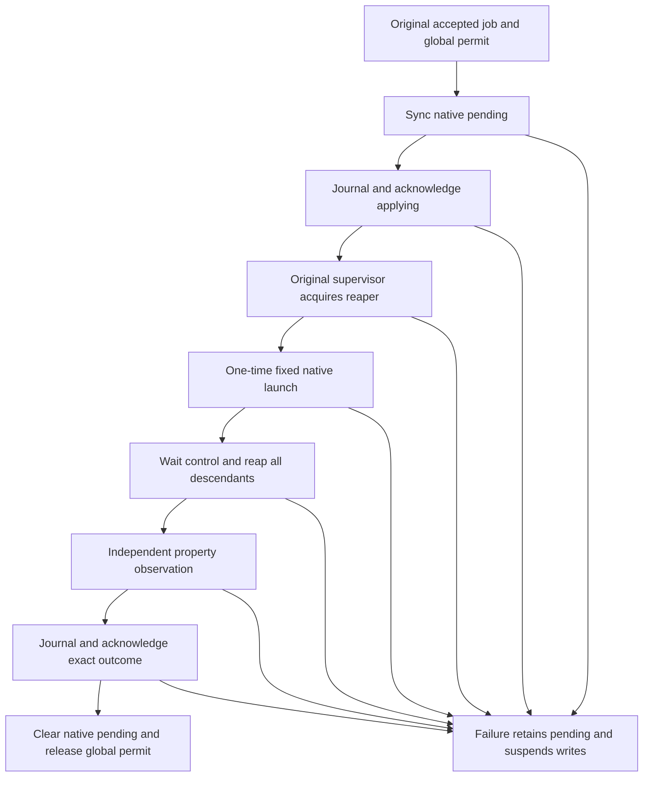

# Property executor recovery mechanism: EDD and Test Design amendment

Status: Accepted design amendment; implementation/native gates pending. Date: 2026-10-08.
Owner: Cam (`@gonz0w`). [Issue 19](https://github.com/gonz0w/horvium/issues/19).
[PRD](PRD.md), [EDD](EDD.md), [Test Design](TDD.md),
[runtime contract](property-runtime.md),
[ADR 0009](../../adr/0009-property-executor-recovery-mechanism.md).

This is the concrete mechanism decision portion of M2-RUNTIME-001. Maintainer
merge of PR 106 accepted the [experiment](../../research/M2/executor-recovery.md)
at source `318ef8ac155f4004051ad6f4287fa8de2109a5a5`. That evidence remains bound
to executed source `de3f028a8e579ece4843bcca59a8cbeb06d4588f`. Maintainer merge of [PR 107](https://github.com/gonz0w/horvium/pull/107) at source
`02a995e5681f38b4a40141402dd2d0a9f0244933` accepted this mechanism and test plan.
Acceptance does not convert research into runtime qualification.

## Scope and trusted boundary

The first assembled effect remains one allowlisted quota/reference-quota or
compression change on a reviewed enrolled filesystem GUID. No pool creation,
scrub, resilver, arbitrary program, same-boot process adoption or automatic replay
is covered. Only the original root helper may publish execution state. Clients
receive bounded projections, never serialized authority.

The trusted OS-root boundary includes provisioning, restoring and administrating
the host. Ordinary service users cannot edit either state domain. Root tampering,
unannounced whole-host rollback and VM memory snapshot resume cannot be detected
by a root-owned file alone. Such environments do not qualify automatic clearance.
An operator declaration cannot substitute for executor quiescence: unresolved
same-boot execution still requires a changed qualified kernel boot ID.

## Native identity and supervision

Pinned primary FreeBSD `kern_mib.c` exposes `kern.boot_id` as a read-only sixteen
byte value, generated once after random seeding and retained by the kernel.
Unseeded access can fail. This is source evidence, not an executed native claim:
[14.5 source](https://github.com/freebsd/freebsd-src/blob/231eee334c098a8398bc959202415c48058f67f0/sys/kern/kern_mib.c),
[15.1 source](https://github.com/freebsd/freebsd-src/blob/e38a7085f3a8ecd317c947591fe42b5ca9ab317b/sys/kern/kern_mib.c).
Require exact raw length, successful repeated reads and equality throughout an
original incarnation; failure or a changed identity during operation revokes
clearance. Do not decode these random bytes as a UUID or use a string API that
can trim a trailing zero. Use the existing accepted FreeBSD syscall boundary,
with a fixed-size bounded read rather than allocating from an unchecked kernel
length. A random boot identity has a probabilistic collision assumption and is
not external anti-rollback attestation.

A dedicated root supervisor acquires `PROC_REAP_ACQUIRE` on itself **before**
spawning the guard. Source acquisition does not retroactively attach existing
children. `PROC_REAP_STATUS` must identify the supervisor's own reaper, not init
or an ancestor. The native definitions/implementation are the starting evidence:
[14.5 implementation](https://github.com/freebsd/freebsd-src/blob/231eee334c098a8398bc959202415c48058f67f0/sys/kern/kern_procctl.c),
[15.1 implementation](https://github.com/freebsd/freebsd-src/blob/e38a7085f3a8ecd317c947591fe42b5ca9ab317b/sys/kern/kern_procctl.c),
[header observations](../../research/M2/executor-recovery.md).

Use Go with the existing approved syscall adapter and FreeBSD-only fixed native
structures/constants. Verify each supported architecture's layout against native
headers before claiming support; an unsupported layout returns unavailable. The
1088-byte research `kinfo_proc` is not copied into runtime. No shell or new C
runtime component is required. Process identifiers/timestamps may aid sanitized
diagnostics but cannot grant clearance or select an unrelated process to kill.

The supervisor handles exactly one validated fixed native operation. Original
inherited private descriptors carry a bounded typed request, launch handshake and
completion; no public socket or future user-facing command syntax is chosen here.
Only the helper holding the original leases and global permit may authorize the
effect, after pending state and applying acknowledgement. Copied payloads, a new
connection or reconstructed owner cannot repeat that authorization. Before the
handshake, peer loss forbids launch. After authorization, peer loss cannot imply
the effect was absent; the supervisor retains its original bounded work/cleanup
duties and the journal remains pending.

The supervisor waits for the actual guard/control, reaps adopted children and
requires its owned reaper to have zero children/descendants before reporting
completion. Bound native output and inspection polling. Kernel reaper operations
target the supervisor's own owned subtree; do not signal saved bare PIDs or a
machine-wide process list. Signal delivery, utility exit, a killed count, an empty
pipe or a status sample while an original child can still fork are insufficient.
No nested reaper or escaped-session behavior is assumed covered until tested.

The completion report is accepted only from the original live supervisor channel,
followed by an actual wait for that supervisor. Supervisor death, unsupported
inspection, unresolved descendants, lost acknowledgement or deadline exhaustion
keeps the global slot suspended and pending state intact. A replacement helper
does not attach to a survivor or fabricate its completion. Reaper ownership is
userspace containment evidence; it is not a general fence for asynchronous kernel
storage work. Actual synchronous property-control completion and independent
postcondition observation still need the listed native gates.

## Independent execution journal

Provision one root-owned journal domain on verified local system UFS/ZFS storage,
outside routine ledger exports and the ledger's rollback/snapshot scope. It can
share a boot disk; a new physical disk is not required. A separate ZFS dataset
can provide a distinct restore scope; on UFS, only the qualified file-level
ledger restore procedure may preserve this distinction. A whole-filesystem
restore that replaces both domains is not a ledger-only restore.

The root provisioning workflow establishes one registered ledger binding and
original lifetime leases for both domains. Use the accepted ancestor/descriptor,
UID/mode/ACL, no-follow, single-link, local filesystem and sync/rename discipline;
never repair an unsafe namespace or replace lock objects to obtain clearance.
Acquire the journal lease before the ledger lease everywhere. Only one helper
and registered ledger can own the global launch slot. A different directory or
reconstructed lease cannot mint another writer. Recheck original objects around
every acknowledged transition and revoke on drift or closure.

Journal version 1 has these accepted bounded logical fields. This defines the
immediate internal format obligation, not a config schema or public API. Exact
encoding and pathname must be reviewed with its implementation, not improvised
in a handler.

| Logical field | Required meaning |
|---|---|
| Version and generation | Known version, monotonically advancing unsigned generation; overflow denies writes |
| Installation/ledger binding | Fresh random provisioning identity plus verified protected directory and persistent native system-backing identity; replacements require explicit recovery |
| Original helper incarnation | Fresh random owner identity, exact raw boot ID and active/closed lifecycle; historical identities grant no authority |
| Confirmed census | Domain-separated SHA-256 of the complete sorted validated namespace, length-prefixed names/sizes and exact record content hashes; include the original lock binding |
| Metadata transition | At most one pending before/expected-after census and exact predecessor/successor binding; absence means a confirmed idle publication boundary |
| Native launch | At most one pending original job/submission, reviewed pool/filesystem GUIDs, intent digest and original boot/helper/supervisor identities; absence means no unresolved launch under this protocol |
| Restore barrier | Explicit disarmed state for an in-progress restoration/rebinding; cannot become eligible through ordinary restart |

Bound one encoded journal to 64 KiB, with no embedded inventory or copied job
history. Keep the existing 64 MiB ledger byte cap, ownership count, 64 pending
and 1000 terminal job limits. Compute the complete census by streaming validated
records under the original writer; retain hashes/summaries rather than every file
body. Unknown entries, temporary/orphan files, newer versions, truncated records,
missing bindings, unsupported filesystem identity and over-limit data deny
writes. Hashes detect damage/ledger-only rollback, not root edits or joint rollback.
Measure the cost of full census confirmation; indexing is not silently introduced
to avoid that cost.

## Publication and launch ordering

Keep all runtime ownership/job mutations under the same owner and journal protocol,
including enrollment, admission, progress, outcomes and later hold resolution.
The old private publishers remain useful components; a runtime caller must not
bypass the journal. There is no assumed atomic transaction across directories.

1. Validate the complete current census against the confirmed digest. Validate the
   typed successor and compute the expected resulting digest without changing files.
   Reserve bounded publication capacity in both domains.
2. Sync a journal metadata-pending transition with before/after digests, then
   acknowledge that transition only after file and directory sync.
3. Publish the single exact successor using the existing ledger durability
   discipline. Confirm its acknowledged bytes and complete resulting census.
4. Sync journal confirmation of that census and clear only the metadata-pending
   transition. Return success only after this final acknowledgement. Any failure,
   lost acknowledgement or unexpected census revokes live authority; leave
   recoverable pending intent, never undo a potentially completed effect.

Native launch has an independent pending state that survives steps 1–4. Acquire
the shared global permit and repeat the accepted authority/policy/identity/deadline
checks; durably set native-pending **before** publishing applying intent. Publish
applying with the metadata protocol, establish the original supervisor and its
reaper, then release the one-time launch handshake. A supervisor fork/start/ready
failure starts no control but still requires conservative pending recovery if its
publication or completion is uncertain.

After actual control/descendant completion, independently observe the property
and publish the exact outcome with the metadata protocol. Clear native-pending
and release the global permit only after original supervisor completion/wait,
postcondition observation and exact durable outcome/journal confirmation.
No caller disconnect, session expiry, worker return or helper shutdown can skip
those duties. Retained pool holds are unchanged; even a confirmed success does
not automatically permit another mutation on that pool.

## Commissioning, restart and restoration

| Observed condition | Proposed behavior |
|---|---|
| Explicit fresh OS-root commissioning, valid empty unbound ledger, no prior journal or restore provenance | Exclusively create/sync the new binding; bind live clearance to the original leases only after the complete native/system checks |
| Missing journal with existing ledger, missing ledger with existing journal, or inconsistent partial bootstrap | Observation-only; no reset, automatic initialization or reconstructed authority |
| Fully closed prior incarnation, confirmed census, no pending transition/launch or restore barrier | Eligible for fresh startup review under both exact leases and native/system/policy checks; a closed marker alone is insufficient |
| Unclean active prior incarnation on the same boot, including apparently idle state | Observation-only; no PID-based exception or automatic restart takeover; require an actually changed qualified boot ID |
| Unclean prior incarnation with changed qualified boot ID | Prior userspace cannot retain this original boot identity; inspect all retained work and provenance before any new clearance; keep holds and unresolved jobs |
| Pending metadata transition with confirmed before or expected-after bytes | Expose the exact interrupted boundary for explicit root recovery review; do not automatically clear, replay, delete or resume a job |
| Pending transition with any third census, or ledger rollback/deletion | Deny; preserve both domains and observed discrepancies for restore reconciliation |
| Pending native launch, even with matching properties or a terminal job | Require qualified execution exclusion and explicit recovery decision; never silently erase pending state or pool holds |
| Unknown journal provenance, restore barrier, both domains restored or foreign binding | Observation-only; no automatic clearance from reboot, equal hashes or operator-supplied boolean |

Before granting a new live incarnation, durably publish its fresh identity and
active lifecycle while still holding both original leases. An orderly shutdown
first retires all admission/launch authority, drains accepted workers, waits every
original supervisor, confirms no pending state and the complete census, then
durably closes that incarnation. Only afterward close leases/exit. A failed close
acknowledgement leaves an unclean incarnation; do not report a clean restart.

The restore protocol first stops admissions, drains qualified work or preserves
uncertainty, disarms the independent journal and syncs its restore barrier before
replacing ledger files. The target receives observation-only restored state.
Reconcile fresh native identities, complete record history, lost submission
knowledge and holds explicitly; do not promote an old succeeded record into a
new launch credential. Restoring an older journal too destroys the independent
comparison and needs separately reviewed whole-system recovery. Root operators
must not roll back the journal through ordinary ledger backup tooling.

The first runtime implementation does not automatically erase unknown history,
rebind an old ledger or offer full-host restore acceptance. When provenance cannot
be established, preserve observation-only mode. These limitations must be visible
in operator documentation before installation is qualified.

## Required failing-first tests and native evidence

These are planned tests, not executed cases. They refine M2-RUNTIME-001/002/004,
M2-STATE-001, M2-RECOVERY-001, M2-JOB-001 and M2-PRIV-001.

| Gate | Required portable/negative coverage | Required actual disposable FreeBSD observations |
|---|---|---|
| Boot identity | Exact length, trailing zero, unsupported/error, repeated read change, foreign/copied owner denial | Raw sixteen bytes stable across processes/repeated reads; different after real reboot; native clock changes do not alter it; both targets |
| Supervisor | One-time original handshake, pre-ready/peer-loss denial, copied channel/owner denial, bounded output/deadline | Acquire before children; actual guard/control, escaped sessions and nested-reaper limits; own status, wait/reaping, guard-first/helper-first/supervisor-first death and hanging descendants |
| Journal | Strict bounds/version/duplicate fields, generations, exact predecessor, before/after/third census, no bypass | Both root leases/ACL models, original objects, read-only/full filesystem, file/directory sync failures and every acknowledgement cut; independent preserved sentinel |
| Bootstrap | Empty alone/missing halves/foreign identity/copied lease cannot commission | Actual OS-root provisioning with verified system backing; non-root/inherited-descriptor denial; incomplete creation and same-inode replacement cases |
| Global launch | One shared permit across backends/connections; metadata-pending and native-pending distinct; completion never releases holds | Competing actual root jobs; failed ready, completed quota before outcome, helper/supervisor death with actual surviving original descendants; no second launch |
| Restart | Unclean same-boot always denies, closed marker alone denies, missing boot ID fails; no job replay | Orderly shutdown/restart, changed-boot recovery and exact bytes/holds; active property-command/kernel cut or explicit retained unqualified gap |
| Restore | Old ledger/omitted pending job/rollback digest mismatch, invalidated barrier, overflow/full store and paired missing state | Ledger-only rollback against preserved journal; disarm-before-restore, interrupted restore, deleted pending state and joint-restore denial; no fabricated anti-rollback proof |
| Assembled acceptance | Original admission/independent worker lifetime and runtime gate integration | Both releases, retained affected safety cases, independent file-client continuity, measured census/supervisor resources and complete teardown |

Use only newly owned fixtures, serial existing QEMU guests and supervised cleanup.
Nested reapers, fork races and blocked syscalls need actual kernel observations;
a killed process count is not a pass. No experiment on operator datasets or reboot
of a real NAS is authorized by this proposal. No host service is enabled for
testing. Focus portable reviews on affected code; use milestone full review only
at the accepted assembled boundary. A documentation-only review runs baseline
checks without rerunning unchanged native suites or race/fuzz targets.

## Primary source receipts and implementation order

Primary files were fetched from the pinned official FreeBSD source commits on
2026-10-08. Receipt hashes preserve provenance; none is a native execution result.

| Release | File | SHA-256 |
|---|---|---|
| 14.5 | `sys/kern/kern_mib.c` | `bb6e32b78b85c6ba30659e5a82339889bb700dd9ec8cb4ce03a9ace23f9a35c0` |
| 15.1 | `sys/kern/kern_mib.c` | `4f18697f683e5bc54817e9f0dfdd003a0c4d115cd27f9cf5b91614c8cd8fc2ae` |
| 14.5 | `sys/kern/kern_procctl.c` | `cec327bd2d5b0cd1dca5c356cbb4ca7dae8a373b20d553c56ca4156f9723abde` |
| 15.1 | `sys/kern/kern_procctl.c` | `599405e3d3d22decf1f0feb71e6a45345e54b33b7ada11d6ace71ebeec8ffcd9` |

Implement and qualify native boot identity and the dedicated
supervisor together with their original channel consumers; then implement the
journal, root provisioning and original startup/global launch owner together with
the real backend/publishers. Integrate root dispatch/independent workers and
explicit recovery/hold resolution before shared HTML/CLI exposure. Keep every
existing denial until its consumer and native gates pass. The accepted six
runtime delivery gates still govern the assembled property workflow; other M2
operations, M1 manual accessibility and the NAS release remain separate.

## First implemented prerequisite

The [original boot/reaper property supervisor](../../testing/M2/property-supervisor.md)
implements the first private consumer. Its source-bound amd64 gates passed on both
pinned disposable targets, including native header layouts, raw boot/clock checks,
original channels, escaped/nested descendants, death ordering, retained actual
controls and reboot/readback. Independent journal/provisioning/startup/global and
active kernel-interruption gates above remain open. This partial qualification
neither enables the root listener nor satisfies M2-RUNTIME-001 acceptance.

## Portable journal foundation

The [journal record/census core](../../testing/M2/execution-journal.md) implements
an internal version 1 encoding, damage checksum, exact-byte streaming census and
single-step metadata successor validator. No installation path or native identity
producer is selected. Data validation does not prove publication acknowledgement,
executor completion or write clearance; the original dual-lease owner must enforce
all native ordering above. Its portable consumer/test results do not satisfy any
journal/bootstrap/global/restore native gate. Native owner, provisioning and real
publisher/backend integration remain required together before enabling runtime use.

The [native census reader](../../testing/M2/native-execution-census.md) supplies a
private exact-byte digest through the original ledger lease, retaining all existing
final object/namespace checks and publication uncertainty. Its supplied binding is
metadata only. Persistent identity production, dual-domain journal persistence and
original startup/global ownership still need implementation and native gates with
the real backend/publishers before runtime use.
