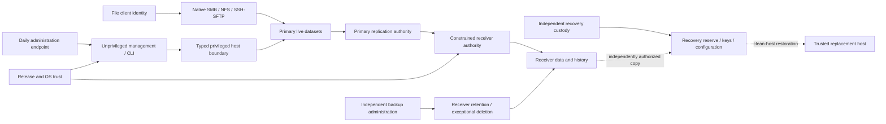

# Whole-system security threat model

Status: Research review candidate; proposed controls require separate design adoption.
Date: 2026-10-18. Owner: Cam (`@gonz0w`).
Owning review: [#167](https://github.com/gonz0w/horvium/issues/167), under
[M7 #136](https://github.com/gonz0w/horvium/issues/136).
Scope: proposed V2-SEC-001–007 in the [security roadmap](../roadmap/v2-security.md).
Source baseline: `546487832a7f76f679334dee75b29eccdd93a171`.

This is a review of authority and failure boundaries for a dedicated FreeBSD NAS.
It supplies threat analysis and bounded future design work, not an approved
PRD/EDD/Test Design packet or a qualified security baseline. Planning can proceed
before first-release completion; second-release delivery still follows it.
The package-first path, local identities, generic FreeBSD hardware scope and
[deployment responsibility guide](deployment-security.md) remain authoritative.
No new process, public interface, dependency, configuration schema or service is
selected here. Issue status, priority and blockers remain in GitHub.

## Review envelope and current evidence

The review covers one primary, file clients, an administrator workstation, a backup
receiver, independently controlled recovery material, and the package/image
supply chain. The same authority analysis applies to a small home server and
larger installations. Additional peers increase exposure; no cluster, HA,
container hosting, directory dependency or fixed hardware topology is assumed.
AI-enabled attackers have the same modeled authorities, with potentially greater
attack volume; the model does not claim to recognize attacker tooling.

The current [M1 access decision](../adr/0005-m1-access-and-state.md) is a lab
loopback/SSH workflow. [Config validation](../../internal/admin/config.go) requires
a loopback listener; [foreground assembly](../../internal/service/service.go)
separates unprivileged management from the root inventory helper. The existing
[session authority](../../internal/admin/session_authority.go) proves a live
application session, not root policy, independent approval or mutation permission.
These inspected mechanisms do not establish a production remote-admin, sharing,
replication, encryption, confinement or appliance claim. Private M2 primitives and
their receipts do not establish an enabled integrated storage writer.

Existing accepted designs and source-bound evidence keep their actual scope.
M1 manual accessibility, M2 startup/runtime and dashboard qualification, M3/M4
protocol/protection, package, hardware and release gates remain separate. In
particular, [publication/idle evidence](../testing/dashboards/witness-metadata-lifecycle.md)
retains the failed 14.5 preparation and unresolved sampled CPU counters. Nothing
in this review reruns, explains away or accepts those observations.

## Assets and required distinctions

| Asset | Security property and loss to model |
|---|---|
| A1 Live files and metadata | Confidentiality of readable data/names; integrity of authorized changes; availability of file service |
| A2 Historical versions and retention policy | Ability to select an unpoisoned checkpoint after delayed discovery; protection from deletion or policy weakening by an excluded principal |
| A3 Identities and access rules | Local users/groups, ACL/ownership mappings and protocol semantics needed to reconstruct permitted access |
| A4 Credentials, encryption and recovery material | Scope, custody, revocation and access when the primary, workstation or encrypted pool is unavailable |
| A5 Management and execution state | Configuration, ownership/job/recovery history, uncertainty and restart authority; a restored file must not recreate active execution permission |
| A6 Evidence and alerts | Independent origin, scope, freshness and completeness; suppression or forged success must remain distinguishable from verified recovery |
| A7 Software and host trust | Release identity, package/image/OS updates, boot/firmware/BMC authority and the clean recovery environment |

Availability, integrity, recoverability and confidentiality are separate outcomes.
A successfully received stream can contain hostile but internally valid edits.
Ciphertext surviving a disaster is not useful recovery without the corresponding
keys, identities and configuration. Encryption does not stop an authorized
component from reading plaintext already exposed to it.

## Attacker authorities

Positions are evaluated separately and in combination. A stronger compromise may
acquire weaker credentials; do not assume credentials or recovery paths remain
independent merely because accounts have different names.

| Position | Attacker can do | Boundary that needs proof | Explicit residual loss |
|---|---|---|---|
| Unauthenticated remote peer | Probe exposed listeners, flood requests, exploit reachable parsers | Exposure, bounded work and denied authentication on every reachable protocol | Upstream network/link exhaustion is not solved by management request limits |
| File client / stolen file identity | Read, modify or delete anything that its protocol/ACL authority allows | Dataset/share scope, cross-protocol identity and independent historical recovery | Authorized readable plaintext can be exfiltrated; valid writes can poison new copies |
| Stolen management session | Submit every action the stolen authority permits and replay captured requests | Exact resource/action authority at the point of effect, expiry/revocation and exceptional-action separation | CSRF and login success alone do not prove operator intent on a compromised endpoint |
| Compromised management or file-service process | Exercise its descriptors, OS identity, network reach and accessible secrets | Actual process authority, narrow root boundary and service-specific data exposure | A service allowed to read a dataset can disclose it; broader privilege/kernel compromise may escape process controls |
| Primary root | Control primary processes, plaintext, clocks, local policy, credentials and reports | Receiver independently enforces its history boundary and holds no administration secrets on the primary | Entire primary may be destroyed or lie; local approval/delay/immutable flags cannot constrain that root authority |
| Replication principal | Use every granted receive operation repeatedly with hostile streams, names and metadata | Destination namespace, receive/property options, retained history and capacity handling | It can consume allowed capacity and deliver poisoned content; successful replication is not a clean checkpoint |
| Backup administrator / receiver root | Reconfigure or destroy its own online receiver and falsify its local evidence | Recovery reserve and any plaintext-key custody are outside that authority | Its online copy may be lost; a receiver-local hold is not independence from receiver root |
| Compromised admin workstation, factor or recovery path | Steal sessions/secrets, approve malicious actions or invoke factor recovery | Independence includes approval devices, credential stores, emergency access and revocation paths | An approving endpoint under attacker control cannot establish trustworthy intent |
| Physical, firmware/BMC or supply-chain authority | Replace boot/software trust or control affected hardware | Declared host/physical scope, trusted release verification and independent clean recovery | A compromised common trust root can defeat both nominally separate hosts |

## Trust boundaries and flows

The diagram describes proposed target responsibilities, not deployed components.
Solid arrows identify flows that need authenticated, bounded contracts; they do
not confer trust merely by existing.

| Boundary | Required review question |
|---|---|
| B1 Client to file service | Which data and metadata does each authenticated identity reach through each enabled protocol, including combined permissions and repeated actions? |
| B2 Browser/CLI to management | Which action, resource, lifetime and recovery path does the authority actually cover? Are UI/CLI/helper alternatives equally constrained? |
| B3 Management to root/OS | Does the receiver independently validate typed intent, stable object identity, current policy, drift and launch/recovery clearance? A session is insufficient. |
| B4 Primary to backup receiver | Can hostile receive options, stream properties, namespace selection or repeated operations affect protected history or unrelated resources? |
| B5 Normal receive to retention administration | Can normal credentials, configuration edits, space pressure or restore/clock changes weaken the receiver-owned protection window? |
| B6 Online hosts to reserve and key custody | Can either compromised host or its normal credentials reach, rewrite or unlock the only reserve? How is authorized replenishment isolated? |
| B7 Product/OS/image trust to installed host | How are release identity, unsupported versions, interrupted updates and recovery verified without silently replacing operator trust or pool features? |
| B8 Host to external evidence and emergency administration | Which independent observations survive host lies, lost collectors, credential loss and compromised recovery workflows? |

Independence is a property of the complete authority graph. Shared administrator
workstations, reused passwords/SSH keys, credential-vault recovery, privileged
automation, update signers, BMC access or writable configuration backups can join
supposedly separate domains. Geographic distance, a private subnet or a second
NAS label alone does not establish B4–B8.

## Review findings and failure paths

1. **Independent history must be enforced on the receiver.** A primary that can
   select destructive receive behavior or alter retention can defeat a backup
   policy even if a management UI omits delete. Upstream OpenZFS documents receive
   rollback and snapshot/filesystem destruction with `-F`; the future contract
   must qualify exactly the permitted behavior and cumulative authority, not copy
   arbitrary sender options. [OpenZFS receive reference](https://openzfs.github.io/openzfs-docs/man/v2.3/8/zfs-receive.8.html).
2. **A transport credential is also a storage authority decision.** Review
   receiver-local and descendant delegation, identity changes, properties and
   transitive delegation separately from SSH authentication. Upstream delegation
   is a mechanism reference, not a Horvium authorization contract or FreeBSD
   compatibility result. [OpenZFS delegation reference](https://openzfs.github.io/openzfs-docs/man/v2.3/8/zfs-allow.8.html).
3. **Root compromise moves the recovery boundary off that host.** Same-host
   confirmation, delays and holds cannot supply an independent root authority.
   A receiver-root scenario needs a separately controlled reserve; a compromised
   primary must not contain the receiver administrator's credentials. Independent
   custody and actual restoration are required design outcomes. CISA also calls
   for offline backups and regular recovery testing; this model adapts that
   direction to Horvium without asserting that an operator's reserve exists.
   [CISA recovery guidance](https://www.cisa.gov/stopransomware/ransomware-guide).
4. **Stream confidentiality and restorability need one key-custody design.**
   Upstream raw encrypted sends can transfer encrypted data without loaded source
   keys; non-raw sends differ. A design must test the bundled versions, received
   properties, metadata exposure, key loss/compromise and replacement-host restore.
   No raw-send support or key lifecycle is adopted by this review.
   [OpenZFS send reference](https://openzfs.github.io/openzfs-docs/man/v2.3/8/zfs-send.8.html).
5. **Confinement must follow actual service authority.** Inventory descriptors,
   writable mounts, privileged helpers and outbound reach first. Capsicum offers
   descriptor-oriented capability facilities, but their existence does not prove
   that Horvium or a file daemon is confined. No jail, container framework or other
   confinement mechanism is selected. Compatibility, restart/update and recovery
   behavior require a native spike and accepted ADR.
   [FreeBSD security facilities](https://docs.freebsd.org/en/books/handbook/security/).
6. **Protection claims need evidence outside the compromised reporter.** A green
   primary dashboard cannot prove that receiver history, external alerts or a
   reserve are intact. Lost or stale evidence remains unknown, with bounded
   redacted export. Documented configuration, host observation and independently
   exercised recovery must retain distinct scopes.
7. **Restoration is also a trust migration.** A clean host needs independently
   selected files/history, identity/ACL mappings, configuration, compatible
   software and keys. Suspect executable/configuration state, active sessions,
   job authority or retired ownership must not silently become trusted again.
   Availability objectives and acceptable historical loss remain operator/design
   inputs, not invented guarantees for every hardware profile.

## Abuse and recovery scenario catalog

These are proposed acceptance questions for future Test Designs, not executed
tests or commands to run on live systems. All future attacks use disposable
fixtures with declared sentinel data, independently held expected results and
verified teardown. A denial counts only if the protected object and resulting
state are independently reobserved.

| Scenario | Authority, attempt and observable future evidence | Proposed outcome / boundary |
|---|---|---|
| TM-01 | Unauthenticated peer drives allowed/denied IPv4/IPv6 and malformed/slow protocol requests; record actual exposure, bounded work and file-service continuity across management restart | 004, 005 / B1–B3, B7 |
| TM-02 | Stolen file identity reads/writes/deletes within and outside its scope through SMB/NFS/SFTP, including cross-protocol ACL/ownership and cumulative changes; compare permitted data and restored sentinel history | 002, 004, 007 / B1, B4–B6 |
| TM-03 | Stolen session replays an action, changes its target after review or uses a different UI/CLI/helper path; original exact action/resource authority denies every unauthorized effect | 001, 006 / B2–B3 |
| TM-04 | Compromised approving workstation or factor-recovery path tries to authorize protected-history deletion and re-enroll authority; independently enforced policy and remaining emergency recovery are observed | 001, 006 / B2, B5, B8 |
| TM-05 | Primary root and, separately, replication-only authority submit destructive receive behavior, hostile names/properties, alternate targets and repeated requests; receiver-owned sentinel history/policy/secrets remain outside their scope | 002, 006 / B4–B5 |
| TM-06 | Receiver fills or goes offline during incremental/resumed transfer while hostile new data arrives; refuse unsafe work without silently pruning protected history, and preserve explicit stale/failure state | 002, 005 / B4–B5, B8 |
| TM-07 | A peer identity changes, old trust is replayed or capabilities differ; no silent re-pairing, pool-feature upgrade, target escape or expansion of receive authority | 002, 003, 006 / B4, B7 |
| TM-08 | Receiver root destroys/falsifies its online copy; restore selected files from a reserve outside its authority and demonstrate the actual plaintext-key boundary and irretrievable losses | 002, 003, 007 / B6, B8 |
| TM-09 | Wrong/lost/compromised keys, interrupted encrypted streams and retained historical copies; test actual metadata exposure and restore with separately held material; record what rotation/revocation does and cannot undo | 003, 007 / B4, B6 |
| TM-10 | Exploited management/file daemon attempts unrelated filesystem, secret, device, helper and outbound access; observe actual OS boundary and permitted protocol continuity after restart/update | 004 / B1–B3, B7 |
| TM-11 | Primary forges success, logs are suppressed and external evidence expires; posture must expose missing freshness/independent proof without leaking paths, credentials or customer content | 005 / B8 |
| TM-12 | Clock rollback, reboot, restored old configuration, concurrent cancellation and repeated allowed actions target delayed/exceptional deletion; independently enforce policy and preserve history plus local emergency access | 001, 002, 006 / B3, B5–B8 |
| TM-13 | Altered/wrong-signer/unsupported package or image, interrupted install/update and lost network policy; verify clean recovery, unselected-device preservation and no implicit storage rollback or active-authority resurrection | 004, 005, 007 / B3, B7–B8 |
| TM-14 | Primary and normal workstation are unavailable after gradual valid corruption; reject the newest bad checkpoint, independently choose older history and restore files, identities/ACLs and services on a clean host | 002, 003, 005, 007 / B1, B6–B8 |

TM outcome numbers abbreviate V2-SEC-001–007. Test packets must expand them to the
original IDs, name the exact attacker principal and permitted interfaces, and
supply positive controls as well as denials. Global outage, upstream compromise
and exhausted recovery material remain explicit residual cases; do not turn an
unexecuted or incomplete scenario into a passed control.

## Bounded future work and adoption order

The existing [#297–#303 trackers](../roadmap/github-roadmap-index.md) own the seven
proposals. Each first slice below is a **design/research outcome**, not permission
to implement the whole feature or a new API. Keep child implementation slices
bounded when their owner is picked up; accepted PRD/EDD/Test Design and necessary
ADRs precede code. These logical dependencies do not replace GitHub blockers.

| Owner and proposal | First bounded packet and its decision | Evidence that packet must design |
|---|---|---|
| [#297](https://github.com/gonz0w/horvium/issues/297) / V2-SEC-001 | Separate routine and exceptional authority, including factor recovery/revocation and compromised approving endpoint; select factors only after requirements/dependency review | TM-03/04/12; exact resource/action lifetime, loss/replay/changed-intent and emergency recovery |
| [#298](https://github.com/gonz0w/horvium/issues/298) / V2-SEC-002 | Receiver-owned protected-history and capacity contract: namespace, principals, permitted receive effects, retention exceptions and independent reserve boundary | TM-02/05/06/07/08/12/14; actual primary-root/replication/receiver-root roles, full/offline behavior and preserved sentinel history |
| [#299](https://github.com/gonz0w/horvium/issues/299) / V2-SEC-003 | Key/stream custody and replacement-host restore contract; identify plaintext readers, metadata exposure, separately recoverable secrets and rotation consequences | TM-07/08/09/14; wrong/lost/old keys, interrupted streams, compatible FreeBSD/ZFS versions and recovered files |
| [#300](https://github.com/gonz0w/horvium/issues/300) / V2-SEC-004 | Inventory one actual service's necessary descriptors/files/privileges/network reach, then compare base-facility alternatives in a bounded spike and ADR | TM-01/02/10/13; hostile service fixture, unrelated-data denial and unchanged protocol/update/recovery/resource behavior |
| [#301](https://github.com/gonz0w/horvium/issues/301) / V2-SEC-005 | Define evidence origin, freshness and failure semantics for one protection claim, including independently controlled receiver/recovery evidence and redaction | TM-01/06/11/13/14; forged primary success, missing/stale observers, bounded export and preserved uncertainty |
| [#302](https://github.com/gonz0w/horvium/issues/302) / V2-SEC-006 | Bind one exceptional trust/key/retention change to independently enforced authority and its cancellation/recovery contract; evaluate delays without treating them as independence | TM-03/04/05/07/12; repeated operations, bypass paths, clock/boot/restore races and full-store pressure |
| [#303](https://github.com/gonz0w/horvium/issues/303) / V2-SEC-007 | Specify one clean replacement-host restoration exercise without the primary or normal workstation; list artifacts/custodians and independently chosen checkpoint | TM-02/08/09/13/14; suspect/newest-bad history, identity/ACL/config/key recovery, representative file access and measured recovery limits |

Resolve receiver authority and recovery-custody assumptions before promising
independent-history or key guarantees. Administrative and exceptional-change
packets share an exact-action/recovery decision. Confinement follows an inventory
of real service needs; posture follows the evidence contract it reports. Recovery
can be designed in parallel but its execution must use the finally adopted trust,
retention, key and identity contracts. No blanket sequence/date or prerequisite
cycle is introduced for first-release delivery.

## First release and operator responsibility

Basic safety remains in the existing [M1–M7 phases](../roadmap/milestones.md):
M3 owns local identities/protocol permission tests; M4 owns explicit peer trust,
constrained replication, retention and real restoration; M5/M6 own package/update,
security and recovery qualification. M7 consumes the same tested package and adds
installer/boot/host-policy evidence. V2 work strengthens these contracts; it does
not defer their existing obligations or require an image for a package install.

Operators must decide data criticality, history/notice periods, acceptable loss
and recovery time, credential/key/reserve custody and physical/network access.
The product must expose unmet dependencies without asserting that external
networks, firmware, workstations or offline material are safe. A package must not
take over unrelated firewall/SSH/services; an image's additional host policy needs
its own approved design and qualified hardware/OS scope. Home deployment may use
simpler custody, but a weaker independence boundary must be stated honestly.

## Open decisions and review exit

Unresolved design choices are: routine versus exceptional authorization and factor
recovery; receiver privileges/retention exceptions/capacity; reserve ownership and
replenishment; encryption/key recovery and stream compatibility; actual service
confinement; independent evidence retention/freshness; OS/package/image update
trust and clean recovery. No values, formats or mechanisms are invented to close
them. Record each resolution in its owning packet/ADR and carry its residual
attacker authority into the Test Design and operator guide.

The #167 review outcome is a complete authority/assets/boundaries model for all
seven proposed outcomes, scenario traceability, explicit residual risks and the
bounded handoffs above. The accompanying [review record](threat-model-review.md)
records the source inspection, coverage and limitations. Merging that research
review can complete #167; it does not approve the seven feature designs, close
#136 or any first-release gate, run a hostile/native experiment, or qualify a
compromise guarantee. Keep failed/skipped/native/browser/performance limits intact.
